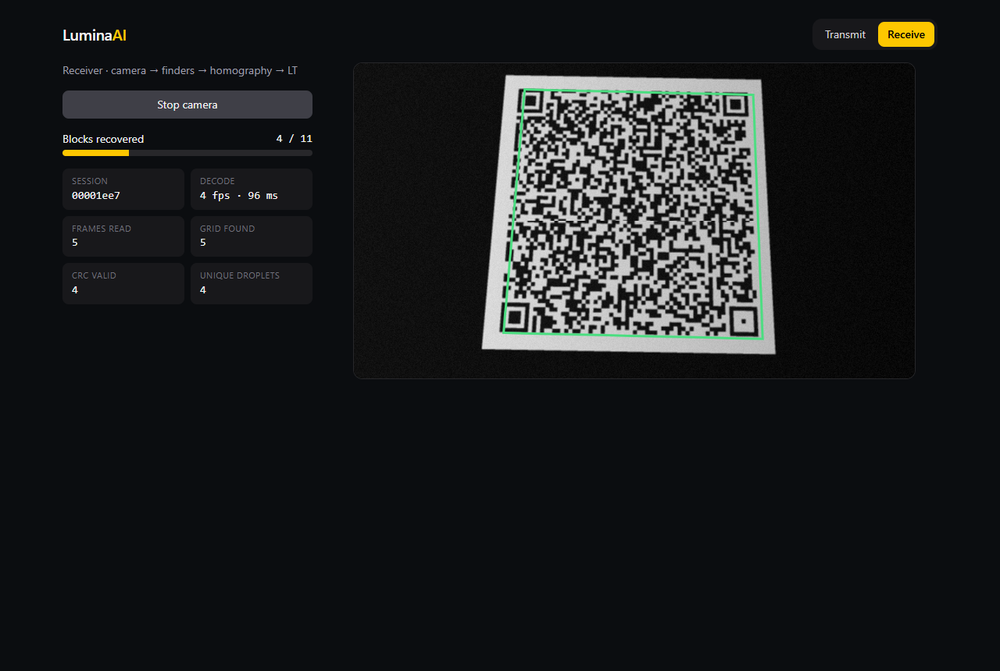
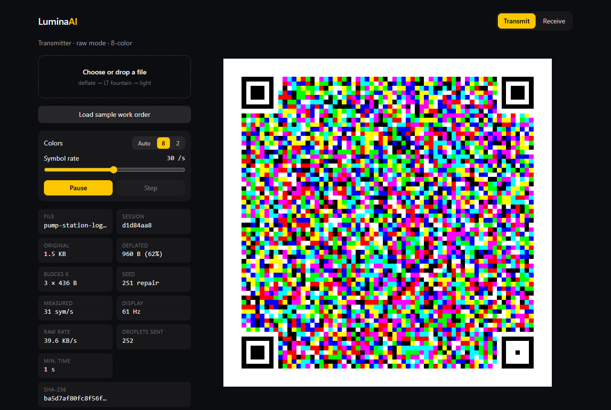

# LuminaAI

**A verifiable light-bridge for air-gapped machines.** Move files and AI agent context into (and out of) isolated systems using only a screen and a camera, with no network, RF, or USB involved.

> Built for the **Meta Global AI Developer Hackathon** (Indie track, *Push the Frontier*), Oct 26 – Nov 4, 2026. See [docs/PLAN-10-DAY.md](docs/PLAN-10-DAY.md).

## Why

Industrial control systems, lab instruments, energy and manufacturing OT networks, and robot controllers are deliberately air-gapped. Getting updated context, configs, or work orders into them means sneakernet USB sticks, which bring their own attack surface (BadUSB). A screen and a camera create a one-way, inspectable, physically line-of-sight channel. LuminaAI makes that channel fast, robust, and *verifiable*:

1. **Semantic packing (Muse Spark, connected side).** Distills large manuals, logs, or work orders into a compact, schema-checked JSON bundle before transmission.
2. **Red-team before sending (Muse Glimmer 30B, connected side).** A second Meta model attacks each bundle against its source document, on top of deterministic grounding checks, so a wrong or tampered order is flagged before it leaves.
3. **Rateless fountain codes in color matrices.** The sender loops LT-coded frames. The receiver can join at any moment, skip any frames, and still reconstruct the payload.
4. **Screen lock-on (SAM 3.1, connected side).** Text-prompted video tracking acquires the far screen for the return channel. Classical finder-pattern tracking and homography handle every frame.
5. **Offline policy gate (air-gapped side).** Every received work order is checked on the device against the local site policy (assets, setpoint limits, injected instructions) before anything is applied. It never calls the network and it fails closed: a tampered order is rejected, a clean one is held until a local verifier model has checked it too. Cloud models run only on the connected sender; [why](META_AI_INTEGRATION.md#where-each-model-runs-and-why).

## What was built during the hackathon

The hackathon's rules require new work only. Everything in this repo was written for this event.

| Commit / tag | When | Note |
|---|---|---|
| `pre-kickoff` (ef34d82) | Oct 26, 09:27 ET | **Before the 12:00 PM ET kickoff**: LT codec, frame format, and docs, written ~2.5 h early. Disclosed openly. |
| everything after | Oct 26 kickoff → Nov 4 | All app, vision, model integration, and UI work |

## Repo layout

```
packages/lumina-protocol   LT fountain codec, frame format, grid, camera-frame reader, file envelope (zero deps)
packages/lumina-agents     Meta models: Muse Spark packer, Glimmer red-team, policy gate + verifier agent, SAM 3.1 client
apps/web                   React PWA: transmitter, receiver, signed return channel
docs/                      Architecture, 10-day plan, decisions
```

## Try it in 2 minutes (no install)

You need a laptop and a phone. Open **https://singhsahab555.github.io/lumina-ai/** on both.

1. **Laptop, Transmit tab → Meta AI packer → "Replay recorded Meta AI pack".** This replays a real run in which a Meta model distilled a 45-day, 55 KB pump-station shift log into a 1.6 KB schema-checked work order. You'll see each attempt and the 7 resulting steps. The site is static, so it can't hold a model key; run `npm run dev` locally for a live pack.
2. **Click "Replay recorded red-team".** Muse Glimmer 30B attacked this bundle against the source log and found nothing (CLEAR). Try **"Attack demo: stage a tampered copy"** too: Glimmer flags the 9 bar limit and the injected interlock bypass.
3. **Click "Beam this bundle over light".** The laptop starts flashing an 8-color grid.
4. **Phone: switch to Receive, turn on airplane mode, tap Start camera,** and point it at the grid. Cover the screen with your hand for a moment if you like; the fountain code doesn't care which frames are missed.
5. The phone shows **SHA-256 verified, byte-exact**, runs the site-policy gate offline (clean order HOLD, tampered order **REJECTED**), and can beam a signed ack back to the laptop. No network at any point.

## Quick start

```bash
# Node >= 22.18 (runs TypeScript natively, no build step)
npm install
npm test                       # protocol + web tests

cd apps/web
npm run dev                    # http://localhost:5173  (Transmit tab; Receive tab = #rx)
npm run build && npm run capture   # headless Edge: re-capture screenshots + test fixtures
npm run build && npm run e2e       # headless Edge, fake webcam: 30 KB file in 2-color, 8-color, Auto; prints KB/s
npm run lan                        # HTTPS on your Wi-Fi (port 4443) so a phone can use its camera
```

### Laptop → phone over light

Live app (HTTPS, installable, works offline): **https://singhsahab555.github.io/lumina-ai/**

1. On the phone open the link, tap **Add to Home screen** (installs the offline app), then open it and switch to **Receive**. Allow the camera when asked.
2. Turn on **airplane mode** on the phone.
3. On the laptop open the same link, **Transmit** tab, load a file. On the phone tap **Start camera** and point it at the grid so it fills at least a third of the view.
4. The phone shows **SHA-256 verified, byte-exact** and a Download button.

Colors: **Auto** (default) sends 8-color symbols (3 droplets each) with every 4th symbol in 2-color as a fallback. If the phone reads only 1.00 droplets/frame, switch the transmitter to **2**. In the fake-camera e2e, 8-color reaches 14.6 KB/s vs 4.6 KB/s for 2-color.

Local alternative: `npm run lan` in `apps/web` serves self-signed HTTPS on port 4443 (phones may restrict the camera on it).

The reverse direction also works without certificates: phone transmits (plain `http://` LAN URL is fine), laptop webcam receives on `localhost`.





## Docs

- [Architecture](docs/ARCHITECTURE.md)
- [10-day build plan](docs/PLAN-10-DAY.md)
- [Build log with measured numbers](docs/LOG.md)
- [Meta AI integration](META_AI_INTEGRATION.md)

## Meta models used

- **Muse Spark Open** on Baseten: semantic packing on the connected side (the recorded run in the live app: 1 attempt, 16 s). **Muse Spark** on the Meta Model API takes over once the API account is active.
- **Muse Glimmer 30B** (Meta open weights) on NVIDIA NIM, connected side: packer fallback, and a red-team pass on each bundle before it is sent (clean order CLEAR in 122 s; tampered order FLAGGED in 91 s on exactly the two bad steps)
- **SAM 3.1**, via the Meta Model API: screen acquisition and tracking on the connected side
- **Muse Glimmer 30B** on plant hardware (Ollama) is the intended optional verifier behind the policy gate. It is not run in the demo, because the demo hardware can't hold it, and we never move it to the cloud. See [Where each model runs, and why](META_AI_INTEGRATION.md#where-each-model-runs-and-why).

Model weights are never committed to this repo.

## License

MIT (code). Model weights are subject to their own licenses.
