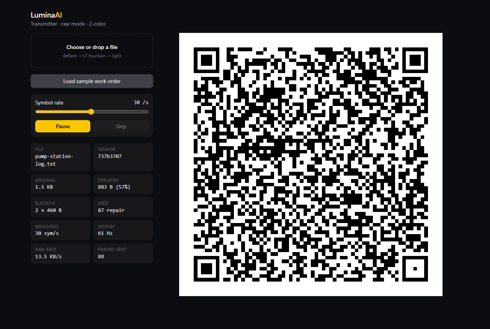

# LuminaAI

**A verifiable light-bridge for air-gapped machines.** Move files and AI agent context into (and out of) isolated systems using only a screen and a camera, with no network, RF, or USB involved.

> Built for the **Meta Global AI Developer Hackathon** (Indie track, *Push the Frontier*), Oct 26 – Nov 4, 2026. See [docs/PLAN-10-DAY.md](docs/PLAN-10-DAY.md).

## Why

Industrial control systems, lab instruments, energy and manufacturing OT networks, and robot controllers are deliberately air-gapped. Getting updated context, configs, or work orders into them means sneakernet USB sticks, which bring their own attack surface (BadUSB). A screen and a camera create a one-way, inspectable, physically line-of-sight channel. LuminaAI makes that channel fast, robust, and *verifiable*:

1. **Semantic packing (Muse Spark, connected side).** Distills large manuals, logs, or work orders into a compact, schema-checked JSON bundle before transmission.
2. **Rateless fountain codes in color matrices.** The sender loops LT-coded frames. The receiver can join at any moment, skip any frames, and still reconstruct the payload.
3. **Screen lock-on (SAM 3.1, connected side).** Text-prompted video tracking acquires the far screen for the return channel. Classical finder-pattern tracking and homography handle every frame.
4. **Offline verifier agent (Muse Glimmer, air-gapped side).** A local open-weights model checks every incoming bundle against local policy before anything is applied, and rehydrates it into an actionable view. No network is needed on the isolated side.

## What was built during the hackathon

The hackathon's rules require new work only. Everything in this repo was written for this event.

| Commit / tag | When | Note |
|---|---|---|
| `pre-kickoff` (67a742d) | Oct 26, 09:27 ET | **Before the 12:00 PM ET kickoff**: LT codec, frame format, and docs, written ~2.5 h early. Disclosed openly. |
| everything after | Oct 26 kickoff → Nov 4 | All app, vision, model integration, and UI work |

## Repo layout

```
packages/lumina-protocol   LT fountain encoder/decoder + optical frame format (zero deps, tested)
packages/lumina-agents     Meta models: Muse Spark packer, Muse Glimmer verifier, SAM 3.1 client
apps/web                   React PWA: transmitter (Day 2), receiver (Day 3)
docs/                      Architecture, 10-day plan, decisions
```

## Quick start

```bash
# Node >= 22.18 (runs TypeScript natively, no build step)
npm install
npm test                       # protocol + web tests

cd apps/web
npm run dev                    # transmitter at http://localhost:5173
npm run build && npm run capture   # headless Edge: re-capture screenshots + test fixtures
```



## Docs

- [Architecture](docs/ARCHITECTURE.md)
- [10-day build plan](docs/PLAN-10-DAY.md)
- [Build log with measured numbers](docs/LOG.md)

## Meta models used

- **Muse Spark**, via the Meta Model API: semantic packing on the connected side
- **SAM 3.1**, via the Meta Model API: screen acquisition and tracking on the connected side
- **Muse Glimmer** (open weights, Apache 2.0, run locally via Ollama): the offline verifier agent on the air-gapped side

Model weights are never committed to this repo.

## License

MIT (code). Model weights are subject to their own licenses.
